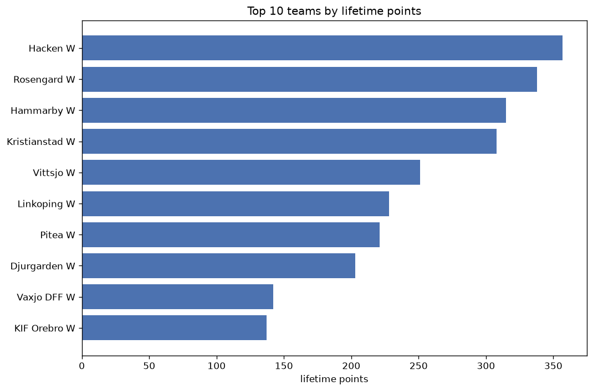
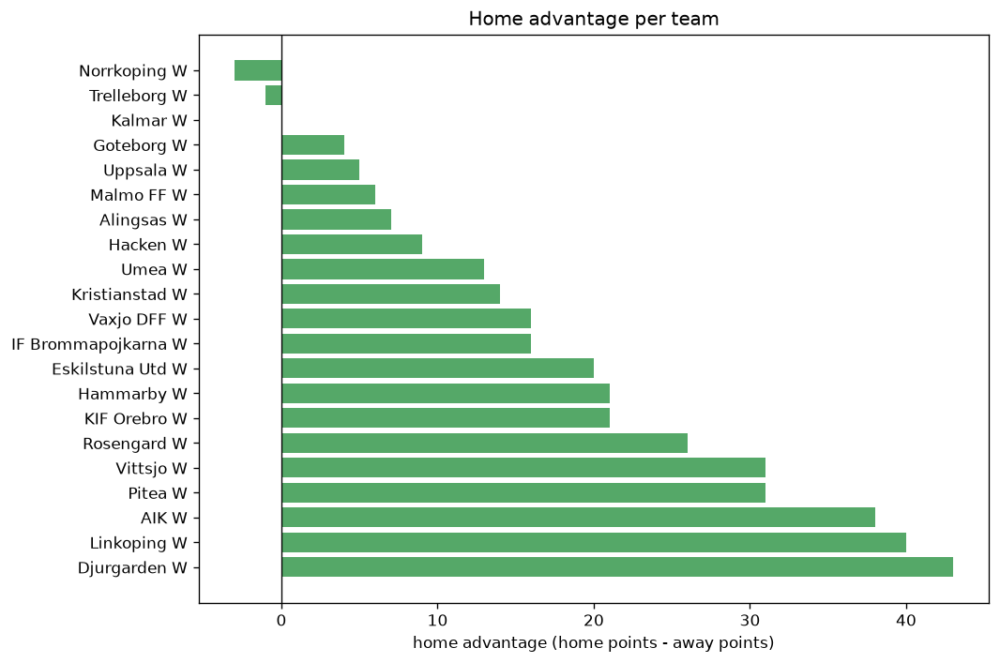

# Team Analysis
- Report: `teams_analysis`
- Generated: 2026-10-26T01:53:33+00:00
- Script: `backend/scripts/analyze_teams.py` v1.0.0
- League: Allsvenskan Women (Sweden)
- Scope: league `wsweden`

- Teams: **21** | Seasons: **7** | Matches: **1151**

## 1. Team standings (lifetime)
| team | seasons | played | W | D | L | pts | GF | GA | GD | avg pts/season | best pos | worst pos | titles |
|---|---|---|---|---|---|---|---|---|---|---|---|---|---|
| Hacken W | 6 | 149 | 112 | 21 | 16 | 357 | 400 | 93 | 307 | 59.5 | 1 | 2 | 2 |
| Rosengard W | 7 | 170 | 103 | 29 | 38 | 338 | 398 | 157 | 241 | 48.29 | 1 | 11 | 3 |
| Hammarby W | 6 | 149 | 99 | 18 | 32 | 315 | 335 | 128 | 207 | 52.5 | 1 | 7 | 1 |
| Kristianstad W | 7 | 171 | 90 | 38 | 43 | 308 | 325 | 212 | 113 | 44.0 | 3 | 6 | 0 |
| Vittsjo W | 7 | 170 | 71 | 38 | 61 | 251 | 236 | 225 | 11 | 35.86 | 5 | 10 | 0 |
| Linkoping W | 6 | 148 | 67 | 27 | 54 | 228 | 261 | 230 | 31 | 38.0 | 3 | 13 | 0 |
| Pitea W | 7 | 170 | 63 | 32 | 75 | 221 | 199 | 231 | -32 | 31.57 | 4 | 11 | 0 |
| Djurgarden W | 7 | 171 | 57 | 32 | 82 | 203 | 210 | 282 | -72 | 29.0 | 4 | 11 | 0 |
| Vaxjo DFF W | 6 | 145 | 39 | 25 | 81 | 142 | 144 | 274 | -130 | 23.67 | 6 | 13 | 0 |
| KIF Orebro W | 5 | 122 | 40 | 17 | 65 | 137 | 134 | 198 | -64 | 27.4 | 7 | 13 | 0 |
| Norrkoping W | 4 | 101 | 36 | 23 | 42 | 131 | 120 | 137 | -17 | 32.75 | 5 | 12 | 0 |
| Eskilstuna Utd W | 4 | 93 | 38 | 14 | 41 | 128 | 112 | 119 | -7 | 32.0 | 4 | 10 | 0 |
| AIK W | 5 | 122 | 35 | 17 | 70 | 122 | 135 | 245 | -110 | 24.4 | 5 | 14 | 0 |
| IF Brommapojkarna W | 5 | 127 | 31 | 21 | 75 | 114 | 155 | 273 | -118 | 22.8 | 7 | 12 | 0 |
| Malmo FF W | 2 | 49 | 31 | 9 | 9 | 102 | 103 | 44 | 59 | 51.0 | 3 | 3 | 0 |
| Goteborg W | 1 | 22 | 17 | 3 | 2 | 54 | 55 | 10 | 45 | 54.0 | 1 | 1 | 1 |
| Umea W | 2 | 48 | 9 | 8 | 31 | 35 | 42 | 108 | -66 | 17.5 | 11 | 13 | 0 |
| Uppsala W | 3 | 71 | 8 | 11 | 52 | 35 | 67 | 187 | -120 | 11.67 | 12 | 14 | 0 |
| Kalmar W | 2 | 52 | 5 | 7 | 40 | 22 | 35 | 170 | -135 | 11.0 | 11 | 14 | 0 |
| Alingsas W | 1 | 26 | 2 | 3 | 21 | 9 | 19 | 78 | -59 | 9.0 | 14 | 14 | 0 |
| Trelleborg W | 1 | 26 | 0 | 3 | 23 | 3 | 12 | 96 | -84 | 3.0 | 14 | 14 | 0 |

## 2. Home vs away split
| team | home P | H-W | H-D | H-L | H-pts | away P | A-W | A-D | A-L | A-pts | adv |
|---|---|---|---|---|---|---|---|---|---|---|---|
| Djurgarden W | 85 | 35 | 18 | 32 | 123 | 86 | 22 | 14 | 50 | 80 | 43 |
| Linkoping W | 74 | 39 | 17 | 18 | 134 | 74 | 28 | 10 | 36 | 94 | 40 |
| AIK W | 61 | 24 | 8 | 29 | 80 | 61 | 11 | 9 | 41 | 42 | 38 |
| Vittsjo W | 85 | 41 | 18 | 26 | 141 | 85 | 30 | 20 | 35 | 110 | 31 |
| Pitea W | 85 | 37 | 15 | 33 | 126 | 85 | 26 | 17 | 42 | 95 | 31 |
| Rosengard W | 85 | 57 | 11 | 17 | 182 | 85 | 46 | 18 | 21 | 156 | 26 |
| Hammarby W | 75 | 54 | 6 | 15 | 168 | 74 | 45 | 12 | 17 | 147 | 21 |
| KIF Orebro W | 61 | 23 | 10 | 28 | 79 | 61 | 17 | 7 | 37 | 58 | 21 |
| Eskilstuna Utd W | 47 | 22 | 8 | 17 | 74 | 46 | 16 | 6 | 24 | 54 | 20 |
| Vaxjo DFF W | 73 | 20 | 19 | 34 | 79 | 72 | 19 | 6 | 47 | 63 | 16 |
| IF Brommapojkarna W | 63 | 18 | 11 | 34 | 65 | 64 | 13 | 10 | 41 | 49 | 16 |
| Kristianstad W | 86 | 48 | 17 | 21 | 161 | 85 | 42 | 21 | 22 | 147 | 14 |
| Umea W | 24 | 7 | 3 | 14 | 24 | 24 | 2 | 5 | 17 | 11 | 13 |
| Hacken W | 74 | 58 | 9 | 7 | 183 | 75 | 54 | 12 | 9 | 174 | 9 |
| Alingsas W | 13 | 2 | 2 | 9 | 8 | 13 | 0 | 1 | 12 | 1 | 7 |
| Malmo FF W | 24 | 17 | 3 | 4 | 54 | 25 | 14 | 6 | 5 | 48 | 6 |
| Uppsala W | 35 | 4 | 8 | 23 | 20 | 36 | 4 | 3 | 29 | 15 | 5 |
| Goteborg W | 11 | 9 | 2 | 0 | 29 | 11 | 8 | 1 | 2 | 25 | 4 |
| Kalmar W | 26 | 3 | 2 | 21 | 11 | 26 | 2 | 5 | 19 | 11 | 0 |
| Trelleborg W | 13 | 0 | 1 | 12 | 1 | 13 | 0 | 2 | 11 | 2 | -1 |
| Norrkoping W | 51 | 18 | 10 | 23 | 64 | 50 | 18 | 13 | 19 | 67 | -3 |

## 3. Top performers
### Best points per game (PPG)
| rank | team | PPG |
|---|---|---|
| 1 | Goteborg W | 2.46 |
| 2 | Hacken W | 2.40 |
| 3 | Hammarby W | 2.11 |
| 4 | Malmo FF W | 2.08 |
| 5 | Rosengard W | 1.99 |

### Most goals scored
| rank | team | goals |
|---|---|---|
| 1 | Hacken W | 400 |
| 2 | Rosengard W | 398 |
| 3 | Hammarby W | 335 |
| 4 | Kristianstad W | 325 |
| 5 | Linkoping W | 261 |

### Best goal difference
| rank | team | GD |
|---|---|---|
| 1 | Hacken W | 307 |
| 2 | Rosengard W | 241 |
| 3 | Hammarby W | 207 |
| 4 | Kristianstad W | 113 |
| 5 | Malmo FF W | 59 |

### Best defence (goals against per match, standings)
| rank | team | GA/match |
|---|---|---|
| 1 | Goteborg W | 0.455 |
| 2 | Hacken W | 0.624 |
| 3 | Hammarby W | 0.859 |
| 4 | Malmo FF W | 0.898 |
| 5 | Rosengard W | 0.924 |

## 4. Team consistency
- Teams present in all **7** seasons: **5**

Djurgarden W, Kristianstad W, Pitea W, Rosengard W, Vittsjo W

## 5. Head-to-head dominance
- Distinct fixtures: **186** (showing the 15 most frequent)

| fixture | meetings | home wins | draws | away wins | home pct | draw pct | away pct |
|---|---|---|---|---|---|---|---|
| Rosengard W vs Pitea W | 14 | 9 | 1 | 4 | 64.3% | 7.1% | 28.6% |
| Kristianstad W vs Djurgarden W | 14 | 7 | 2 | 5 | 50.0% | 14.3% | 35.7% |
| Pitea W vs Djurgarden W | 14 | 7 | 4 | 3 | 50.0% | 28.6% | 21.4% |
| Rosengard W vs Vittsjo W | 14 | 7 | 4 | 3 | 50.0% | 28.6% | 21.4% |
| Kristianstad W vs Pitea W | 14 | 6 | 3 | 5 | 42.9% | 21.4% | 35.7% |
| Rosengard W vs Djurgarden W | 14 | 6 | 3 | 5 | 42.9% | 21.4% | 35.7% |
| Kristianstad W vs Vittsjo W | 14 | 4 | 5 | 5 | 28.6% | 35.7% | 35.7% |
| Rosengard W vs Kristianstad W | 14 | 4 | 6 | 4 | 28.6% | 42.9% | 28.6% |
| Vittsjo W vs Pitea W | 13 | 8 | 2 | 3 | 61.5% | 15.4% | 23.1% |
| Vittsjo W vs Djurgarden W | 13 | 5 | 4 | 4 | 38.5% | 30.8% | 30.8% |
| Djurgarden W vs Hammarby W | 12 | 8 | 0 | 4 | 66.7% | 0.0% | 33.3% |
| Hacken W vs Hammarby W | 12 | 8 | 0 | 4 | 66.7% | 0.0% | 33.3% |
| Linkoping W vs Vittsjo W | 12 | 7 | 2 | 3 | 58.3% | 16.7% | 25.0% |
| Vaxjo DFF W vs Pitea W | 12 | 7 | 1 | 4 | 58.3% | 8.3% | 33.3% |
| Kristianstad W vs Linkoping W | 12 | 6 | 3 | 3 | 50.0% | 25.0% | 25.0% |

## 6. Position per season (classic view)
_Cells show final position; '-' when the team was absent from that season._

| team | 2020 | 2021 | 2022 | 2023 | 2024 | 2025 | 2026 |
|---|---|---|---|---|---|---|---|
| Hacken W | - | 2 | 2 | 2 | 2 | 1 | 1 |
| Rosengard W | 2 | 1 | 1 | 7 | 1 | 11 | 11 |
| Hammarby W | - | 7 | 5 | 1 | 3 | 2 | 2 |
| Kristianstad W | 3 | 3 | 4 | 6 | 4 | 6 | 4 |
| Vittsjo W | 5 | 5 | 6 | 5 | 10 | 7 | 6 |
| Linkoping W | 4 | 6 | 3 | 3 | 9 | 13 | - |
| Pitea W | 8 | 11 | 7 | 4 | 6 | 9 | 10 |
| Djurgarden W | 9 | 9 | 10 | 11 | 7 | 4 | 9 |
| Vaxjo DFF W | 6 | 12 | - | 8 | 8 | 10 | 13 |
| KIF Orebro W | 7 | 8 | 9 | 10 | 13 | - | - |
| Norrkoping W | - | - | - | 9 | 5 | 5 | 12 |
| Eskilstuna Utd W | 10 | 4 | 8 | - | - | - | 8 |
| AIK W | - | 10 | 14 | - | 12 | 8 | 5 |
| IF Brommapojkarna W | - | - | 12 | 12 | 11 | 12 | 7 |
| Malmo FF W | - | - | - | - | - | 3 | 3 |
| Goteborg W | 1 | - | - | - | - | - | - |
| Umea W | 11 | - | 13 | - | - | - | - |
| Uppsala W | 12 | - | - | 13 | - | - | 14 |
| Kalmar W | - | - | 11 | 14 | - | - | - |
| Alingsas W | - | - | - | - | - | 14 | - |
| Trelleborg W | - | - | - | - | 14 | - | - |

---
*All statistics are computed from PostgreSQL tables (read-only). Run with `python backend/scripts/analyze_teams.py` to regenerate.*

## Charts

